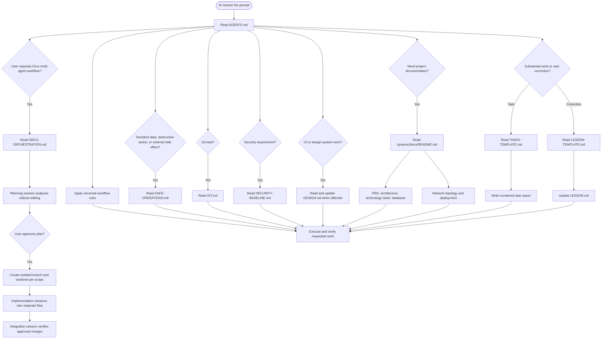

# AgentKnowledge

AgentKnowledge installs shared agent guidance and skills into software projects with a local CLI. It does not require npm publishing or an npm registry.

## AI Decision Pipeline

## Optional Orca workflow: plan → isolated scopes → integration

When a user explicitly asks for multi-agent orchestration, role separation, or parallel work in Orca, first use a read-only planning session. It defines the scope, contracts, file ownership, dependencies, acceptance criteria, and integration approach; implementation begins only after the user explicitly approves that plan.

For each independent scope, create a feature branch and a genuinely separate worktree before opening its implementation session. One writing session owns each branch and its files. Verify the branch and physical checkout for every session—multiple Orca workspaces pointing to the same checkout are not isolated and must not be used for parallel writers.

Each implementation session changes only its approved scope, runs its relevant checks, and reports its commit, changed files, verification, and blockers. A dedicated integration session merges completed feature scope branches into `develop`, runs combined verification, and follows the Gitflow review or pull-request process: production changes reach `main` only through a reviewed `release/*` or `hotfix/*` branch. The workflow is provider-agnostic and has no automatic review-agent stage.

### Orca request examples

Use an explicit request when a task needs a handoff, a dependent sequence, or isolated parallel scopes. A handoff should name the goal, current context, relevant files or worktree, expected result, and next action.

> Use /orchestration to hand this billing settings task to the idle Claude agent. Include the goal, current context, and what they should finish next.

> Use /orchestration to hand this settings cleanup to the agent in the settings-polish worktree. Send the goal, relevant files, and expected result.

> Use /orchestration to run this auth refactor in phases: plan, backend, UI, then tests. Start each child agent after the previous phase is done.

> Use /orchestration to split this auth refactor across parallel child agents: API contract, backend call sites, UI flow, and test gaps.

> Use /orchestration to split this onboarding update into smaller PRs, each in its own child worktree: setup state, settings UI, copy, and tests.

## Recommended Skills

Optional agent skills for focused workflows. Use them when they fit the task and are available in your agent environment.

| Skill | Recommended use |
| --- | --- |
| [codebase-memory](https://github.com/DeusData/codebase-memory-mcp) | Structural codebase questions and impact analysis. |
| [impeccable](https://github.com/pbakaus/impeccable) | UI and UX design, review, and refinement. |
| [Taste Skill](https://github.com/leonxlnx/taste-skill) | Stronger visual direction and frontend design quality. |
| [Matt Pocock's Skills](https://github.com/mattpocock/skills) | Engineering workflows and reusable development practices. |
| [OWASP Secure Agent Playbook](https://github.com/OWASP/secure-agent-playbook) | Security reviews, audits, and agent security workflows. |

## Recommended MCP Servers

Optional tool integrations. Use them when they match the task and are available in your agent environment.

| MCP server | Recommended use |
| --- | --- |
| [FigCraft MCP](https://github.com/storytold/figcraft) | Create and edit designs, inspect documents as JSON, and render previews. |
| [Pencil MCP](https://github.com/highagency/pencil-desktop-releases) | Reading or editing Pencil designs and `.pen` files. |
| [Playwright MCP](https://github.com/microsoft/playwright-mcp) | Browser-based user flows and end-to-end checks. |
| [Chrome DevTools MCP](https://github.com/ChromeDevTools/chrome-devtools-mcp) | Runtime diagnostics for console, network, styles, performance, or memory. |
| [Context7 MCP](https://github.com/upstash/context7) | Current documentation for libraries, frameworks, SDKs, APIs, CLIs, or cloud services. |
| [Sequential Thinking MCP](https://github.com/modelcontextprotocol/servers/tree/main/src/sequentialthinking) | Complex or uncertain multi-step analysis and planning. |

## Requirements

- Node.js 18 or newer
- A checkout of this repository

## One-time setup

From this repository, run:

    node install.mjs

The installer copies the current configuration into your per-user application directory, creates a launcher, and adds its directory to your user PATH. Existing AgentFoundry installations are left untouched: they are not moved, updated, aliased, or removed. Open a new terminal after setup.

## Use from a software project

From the project directory, install the configuration into the current project:

    agent-knowledge init

Pass a target directory to install somewhere else:

    agent-knowledge init ./my-project

The CLI merges directories and asks before replacing each conflicting file in an interactive terminal. If conflicts exist in a non-interactive environment, it stops before writing. Use --force to replace all conflicting files:

    agent-knowledge init ./my-project --force

--force replaces only files that conflict with the bundled configuration; it does not remove unrelated files.

## Updating the installed configuration

Update this repository to the revision you want, then run node install.mjs again from the checkout. The installer refreshes its managed local copy. Existing projects are not changed; run agent-knowledge init in each project to apply updates there.

## Development checks

Run the local test suite without npm:

    node --test

Vendored skills retain their own license and notice files. The top-level license applies to the CLI and original configuration materials; consult each vendored skill's notices for its terms.

## Prompt for first time before ask ai
I want a deeper version of this task, not a bigger one. Before rewriting it: 
(1) say what a top professional in this field would do here that I’m not asking for; 
(2) name the rawest material they would start from instead of what has already been digested for me; 
(3) name the specific methods and tools they would use; 
(4) say what, other than you or me, would show the result is right. Then rewrite my prompt to ask for exactly that
