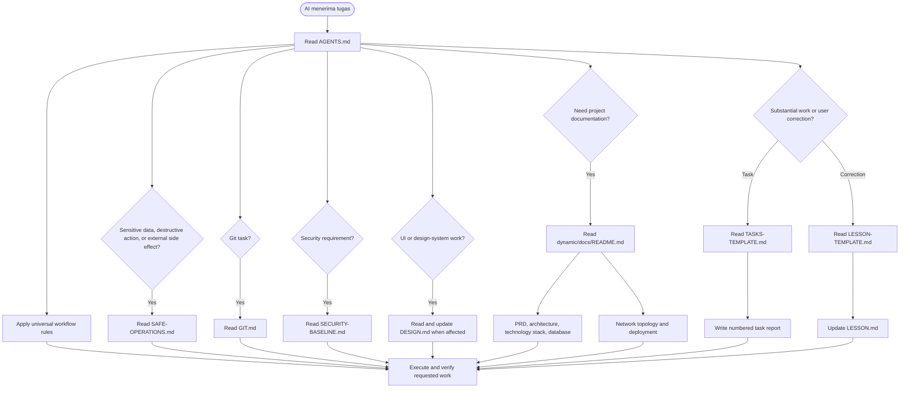

# AgentKnowledge

AgentKnowledge installs shared agent guidance and skills into software projects with a local CLI. It does not require npm publishing or an npm registry.

## Requirements

- Node.js 18 or newer
- A checkout of this repository

## One-time setup

From this repository, run:

    node install.mjs

The installer copies the current configuration into your per-user application directory, creates a launcher, and adds its directory to your user PATH. Existing AgentFoundry installations are left untouched: they are not moved, updated, aliased, or removed. Open a new terminal after setup.

## Use from a software project

From the project directory, install the configuration into the current project:

    agent-knowledge init

Pass a target directory to install somewhere else:

    agent-knowledge init ./my-project

The CLI merges directories and asks before replacing each conflicting file in an interactive terminal. If conflicts exist in a non-interactive environment, it stops before writing. Use --force to replace all conflicting files:

    agent-knowledge init ./my-project --force

--force replaces only files that conflict with the bundled configuration; it does not remove unrelated files.

## Updating the installed configuration

Update this repository to the revision you want, then run node install.mjs again from the checkout. The installer refreshes its managed local copy. Existing projects are not changed; run agent-knowledge init in each project to apply updates there.

## AI Decision Pipeline

## MCP & Skill Recommendations

These are optional recommendations. Use a capability only when it matches the task and is available in the current environment.

| Capability | Recommended use |
| --- | --- |
| `codebase-memory` | Structural codebase questions and impact analysis. |
| `impeccable` | UI or UX design, review, and refinement. |
| Target-specific security skill | Security reviews and audits. |
| Pencil MCP | Reading or editing Pen designs and `.pen` files. |
| Playwright MCP | Browser-based user flows and end-to-end checks. |
| Chrome DevTools MCP | Runtime diagnostics: console, network, styles, performance, or memory. |
| Context7 MCP | Current documentation for libraries, frameworks, SDKs, APIs, CLIs, or cloud services. |
| Sequential Thinking MCP | Complex or uncertain multi-step analysis and planning. |

## Development checks

Run the local test suite without npm:

    node --test

Vendored skills retain their own license and notice files. The top-level license applies to the CLI and original configuration materials; consult each vendored skill's notices for its terms.

## Prompt for first time before ask ai
I want a deeper version of this task, not a bigger one. Before rewriting it: 
(1) say what a top professional in this field would do here that I’m not asking for; 
(2) name the rawest material they would start from instead of what has already been digested for me; 
(3) name the specific methods and tools they would use; 
(4) say what, other than you or me, would show the result is right. Then rewrite my prompt to ask for exactly that
